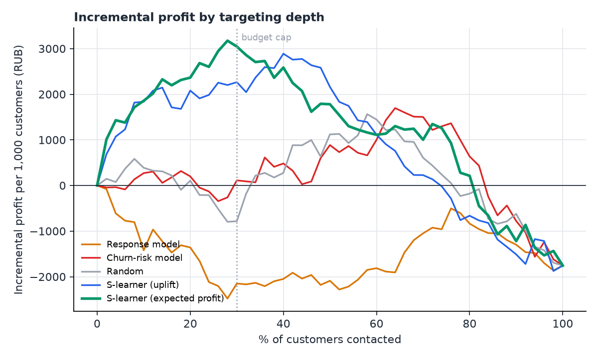

# Uplift Retention Optimizer

**Who should get the retention offer? Not the customers most likely to churn, and not the ones most likely to buy, but the ones whose behavior the offer actually changes.**

This project takes a randomized marketing campaign (X5 Retail Group, 200k loyalty-card customers, SMS offer vs. no contact) and turns it into a targeting policy valued in currency, with confidence intervals, a one-page memo for the CRM lead, and a scoring API.

[](https://github.com/KevinBenass/uplift-retention-optimizer/actions/workflows/ci.yml)

## The problem with the usual targeting lists

Every customer falls into one of four groups, and the offer only pays off for one of them:

| | Buys if **not** contacted | Doesn't buy if not contacted |
|---|---|---|
| **Buys if contacted** | *Sure thing*: the offer is a pure cost | **Persuadable**: the only group worth paying for |
| **Doesn't buy if contacted** | *Sleeping dog*: contact backfires | *Lost cause*: wasted contact |

- A **response model** ("who will buy if we send it?") ranks sure things first, who generate conversions the campaign didn't cause, and who redeem the discount anyway.
- A **churn model** ("who is about to leave?") ranks lost causes highly, who are leaving whatever we send.
- An **uplift model** estimates the *difference* the offer makes for each customer, so it ranks persuadables first.

Then the decision goes one step further than uplift: the offer costs money even when it doesn't change behavior. Each customer is scored by **expected incremental profit**:

```
margin × basket × uplift  −  P(buy | contacted) × redemption × offer cost  −  contact cost
```

and contacted only if that is positive, best first, up to the campaign budget.

## Method

| Step | What | Why |
|---|---|---|
| Features | 45M product-level purchase rows aggregated in **DuckDB** into ~30 features: RFM, 30/60-day trend, loyalty-points earning and burning, basket composition, store spread, card tenure | Out-of-core on a laptop in minutes; all history precedes the campaign, so no leakage |
| Splits | 60/20/20, stratified on treatment × outcome | Each split is itself a valid randomized experiment |
| Learners | **S-, T-, X-, DR-learner and transformed outcome**, all on the same LightGBM base learner | Differences come from the causal strategy, not model capacity |
| Baselines | Random, response model, churn-risk model | What a CRM team would do without uplift modeling |
| Selection | Best **Qini coefficient on validation**; everything reported on test | No test-set peeking |
| Ranking metrics | Qini curve and coefficient, AUUC, uplift@k, decile calibration with CIs | Individual effects are never observed; uplift is judged on groups |
| Policy value | **Inverse-propensity-weighted profit** on the randomized test set, paired bootstrap 95% CIs | Unbiased value for policies that were never run, in currency, not AUC |
| Economics | Margin, contact cost, offer cost, redemption rate in a versioned config; 3×3 sensitivity grid | The decision is only as good as these numbers, so they are explicit and stress-tested |
| Explainability | TreeSHAP on a high-fidelity surrogate of the chosen uplift model, plus a top-vs-bottom segment profile | Answers "what kind of customer does the offer move?" |
| Serving | `uplift score` for batch target lists; FastAPI `POST /score` per customer | The output is a contact list, not a notebook |

## Results on X5 RetailHero

<!-- RESULTS:START -->
_Results are generated by `make all` and written here automatically._
<!-- RESULTS:END -->

The memo for the CRM lead is generated alongside: [`docs/memo_x5.md`](docs/memo_x5.md).

## Simulation study: does the evaluation pick the right model?

On real data the true effect of the offer on each customer is never observed, so every metric above is indirect. To check that the evaluation itself is trustworthy, [`data/synthetic.py`](src/uplift_optimizer/data/synthetic.py) generates data **in the exact X5 schema** from customer archetypes with a **known** true uplift. The same pipeline is then run end to end ([full report](results/synthetic/REPORT.md), [example memo](docs/memo_synthetic.md)).

Findings from the simulated campaign (60k customers, 12k on test):

- **The validation Qini picks the model that is closest to the truth.** The S-learner had the best validation Qini (0.037) and also the highest rank correlation with the true uplift (Spearman 0.51, versus 0.26–0.40 for the other learners). The top two models are the same by both criteria.
- **Uplift targeting is the only policy with a clearly positive profit.** Contacting the top 30% by uplift earned +2,402 RUB per 1,000 customers (95% CI 795 to 4,066). Churn-risk targeting earned +552 (CI −1,157 to 1,902), and contacting everybody lost 1,360.
- **About two thirds of the achievable value is captured.** An oracle that knows the true uplift earns +3,634 per 1,000.
- **The drivers recovered match the simulation's mechanics.** Customers whose recent activity dropped and who habitually redeem loyalty points rank highest.



## Quickstart

```bash
make setup
make all                      # download X5 (~1 GB), build features, train, evaluate, report
make simulate                 # or: the simulation study, no download needed
make api                      # scoring API on :8000
```

```bash
curl -s localhost:8000/score -H 'content-type: application/json' -d '{"customers": [
  {"client_id": "c1", "basket_value": 520, "features": {"recency_days": 21, "tx_30d": 1, "tx_30_60d": 6, "share_tx_points_spent": 0.5}}
]}'
```

Other datasets: `make all DATASET=hillstrom` runs the same pipeline on the Hillstrom e-mail campaign (USD economics).

## Repository layout

```
src/uplift_optimizer/
  data/        download.py · features.py (DuckDB) · synthetic.py (X5-schema simulator)
  models/      learners.py (S/T/X/DR/transformed outcome) · baselines.py
  evaluate/    curves.py (Qini, AUUC, deciles) · policy.py (IPW profit, bootstrap, budget)
  explain.py   TreeSHAP drivers on a surrogate
  pipeline.py  fit → select on validation → evaluate on test
  report.py    figures, README block, CRM memo
  scoring.py · api.py · cli.py
configs/default.yaml   economics per dataset, model and evaluation settings
results/<dataset>/     tables, figures and REPORT.md for each run
```

## Limitations

- **Economics are assumptions.** X5 does not publish margins or the offer's cost; the values in `configs/default.yaml` are plausible for grocery retail, and the sensitivity table shows how the decision changes when they move.
- **Post-campaign spend is not observed in X5**, only whether the customer bought, so revenue is approximated by the customer's historical average basket.
- **One campaign, one offer.** Uplift estimated for this SMS offer does not transfer to a different offer or channel without a new experiment. The memo recommends a champion/challenger rollout with a holdout so the model keeps being measured.

## How this was built

Designed and evaluated by me; implemented with Claude Code. I reviewed every result and made the evaluation and design decisions.

## License

MIT. X5 RetailHero data is provided by X5 Retail Group for research; Hillstrom data by Kevin Hillstrom (MineThatData).
