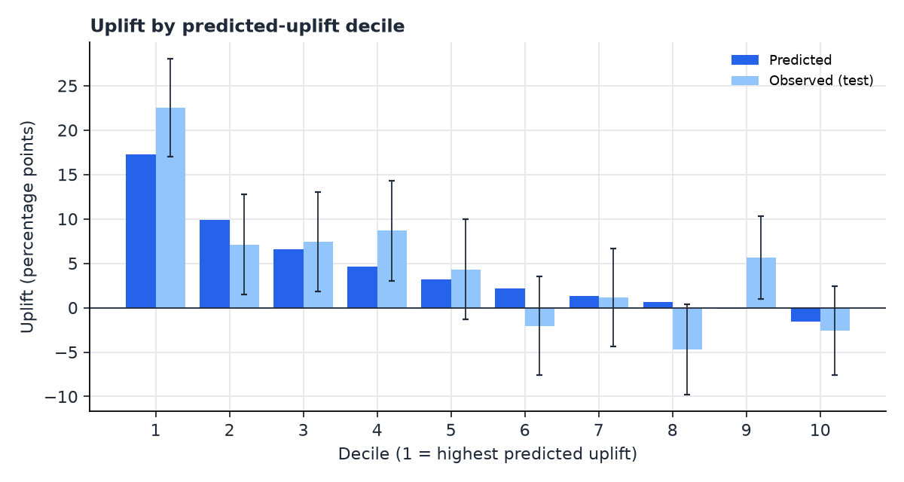

# Results

**Dataset:** `synthetic` · train 36,000 / valid 12,000 / test 12,000 customers · treated share 50% · average effect of the campaign on test: +4.91 pp on a 59.2% base purchase rate.

#### Does targeting by uplift make money? (test set, per 1,000 customers in the base)

| policy                                | contacted   | uplift_in_targeted   | profit_per_1000   | 95% CI          |
|:--------------------------------------|:------------|:---------------------|:------------------|:----------------|
| Contact nobody                        | 0%          |                      | 0                 | [0, 0]          |
| Contact everybody                     | 100%        | +0.049               | -1,756            | [-5,245, 1,350] |
| Random 30%                            | 30%         | +0.037               | -783              | [-2,684, 1,175] |
| Response model, top 30%               | 30%         | +0.007               | -2,149            | [-4,343, -130]  |
| Churn-risk model, top 30%             | 30%         | +0.072               | 112               | [-1,254, 1,494] |
| S-learner uplift, top 30%             | 30%         | +0.124               | 2,264             | [352, 3,988]    |
| S-learner expected profit > 0 (≤ 30%) | 25%         | +0.134               | 2,748             | [668, 4,737]    |
| Oracle (true uplift) ≤ 30%            | 17%         | +0.241               | 2,648             | [1,113, 4,110]  |

#### Ranking quality
Model selected on validation Qini: **S-learner**. Higher Qini = better ranking of who the offer moves.

| model               | kind     | qini_valid   | qini_test   | uplift@10%   | uplift@30%   | spearman_true_tau   | pehe   |
|:--------------------|:---------|:-------------|:------------|:-------------|:-------------|:--------------------|:-------|
| S-learner           | uplift   | 0.049        | 0.037       | 0.225        | 0.124        | 0.529               | 0.074  |
| T-learner           | uplift   | 0.032        | 0.023       | 0.197        | 0.088        | 0.351               | 0.111  |
| X-learner           | uplift   | 0.035        | 0.023       | 0.183        | 0.105        | 0.426               | 0.094  |
| DR-learner          | uplift   | 0.028        | 0.021       | 0.185        | 0.091        | 0.363               | 0.112  |
| Transformed outcome | uplift   | 0.025        | 0.021       | 0.117        | 0.080        | 0.207               | 0.173  |
| Random              | baseline |              | -0.003      | 0.039        | 0.037        |                     |        |
| Response model      | baseline |              | -0.011      | 0.000        | 0.007        |                     |        |
| Churn-risk model    | baseline |              | 0.021       | 0.087        | 0.072        |                     |        |

#### Is the predicted uplift trustworthy?

#### Who are the persuadables?
Surrogate fidelity R² = 0.97.

Median profile of the customers the model ranks highest vs lowest:

| feature               | top 20% uplift   | bottom 20% uplift   | all customers   |
|:----------------------|:-----------------|:--------------------|:----------------|
| tx_30d                | 1.00             | 10.00               | 4.00            |
| reg_points_spent      | 139.30           | 99.60               | 98.60           |
| days_issue_to_redeem  | 377.00           | 341.50              | 362.00          |
| spend_30d             | 590.76           | 5,008.36            | 1,774.42        |
| share_tx_points_spent | 0.27             | 0.09                | 0.18            |
| tx_30_60d             | 4.00             | 11.00               | 5.00            |

#### Sensitivity to campaign economics

| offer_cost   | contact_cost   | share_with_positive_expected_profit   | best_fraction_on_test   | profit_per_1000_at_best   |
|:-------------|:---------------|:--------------------------------------|:------------------------|:--------------------------|
| 7.5          | 1.25           | 43%                                   | 34%                     | 4,220                     |
| 7.5          | 2.5            | 35%                                   | 34%                     | 3,798                     |
| 7.5          | 5.0            | 23%                                   | 24%                     | 3,073                     |
| 15.0         | 1.25           | 31%                                   | 28%                     | 3,523                     |
| 15.0         | 2.5            | 25%                                   | 28%                     | 3,174                     |
| 15.0         | 5.0            | 18%                                   | 28%                     | 2,475                     |
| 30.0         | 1.25           | 17%                                   | 26%                     | 2,023                     |
| 30.0         | 2.5            | 14%                                   | 18%                     | 1,727                     |
| 30.0         | 5.0            | 10%                                   | 18%                     | 1,275                     |
