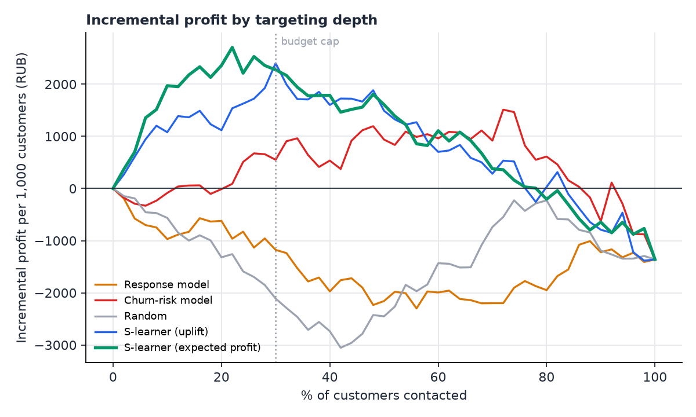
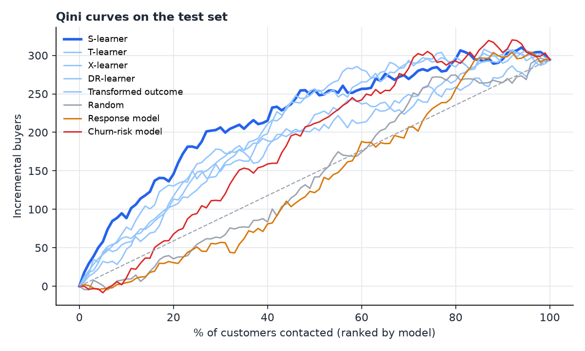
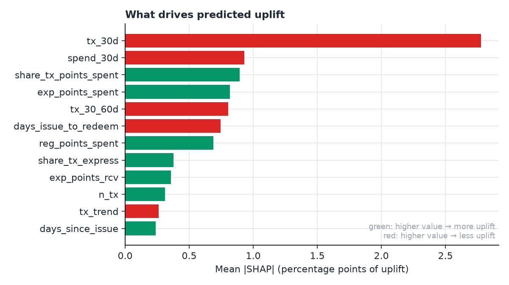

# Results

**Dataset:** `synthetic` · train 36,000 / valid 12,000 / test 12,000 customers · treated share 50% · average effect of the campaign on test: +4.91 pp on a 59.2% base purchase rate.

#### Does targeting by uplift make money? (test set, per 1,000 customers in the base)

| policy                                | contacted   | uplift_in_targeted   | profit_per_1000   | 95% CI          |
|:--------------------------------------|:------------|:---------------------|:------------------|:----------------|
| Contact nobody                        | 0%          |                      | 0                 | [0, 0]          |
| Contact everybody                     | 100%        | +0.049               | -1,360            | [-4,841, 2,033] |
| Random 30%                            | 30%         | +0.036               | -2,110            | [-4,146, -269]  |
| Response model, top 30%               | 30%         | +0.032               | -1,177            | [-3,196, 974]   |
| Churn-risk model, top 30%             | 30%         | +0.061               | 552               | [-1,157, 1,902] |
| S-learner uplift, top 30%             | 30%         | +0.113               | 2,402             | [795, 4,066]    |
| S-learner expected profit > 0 (≤ 30%) | 27%         | +0.106               | 2,346             | [342, 4,260]    |
| Oracle (true uplift) ≤ 30%            | 17%         | +0.241               | 3,634             | [2,212, 5,171]  |

#### Ranking quality
Model selected on validation Qini: **S-learner**. Higher Qini = better ranking of who the offer moves.

| model               | kind     | qini_valid   | qini_test   | uplift@10%   | uplift@30%   | spearman_true_tau   | pehe   |
|:--------------------|:---------|:-------------|:------------|:-------------|:-------------|:--------------------|:-------|
| S-learner           | uplift   | 0.037        | 0.031       | 0.146        | 0.113        | 0.507               | 0.075  |
| T-learner           | uplift   | 0.026        | 0.020       | 0.133        | 0.092        | 0.335               | 0.115  |
| X-learner           | uplift   | 0.029        | 0.027       | 0.098        | 0.098        | 0.396               | 0.098  |
| DR-learner          | uplift   | 0.021        | 0.016       | 0.080        | 0.085        | 0.346               | 0.115  |
| Transformed outcome | uplift   | 0.025        | 0.025       | 0.106        | 0.084        | 0.257               | 0.172  |
| Random              | baseline |              | -0.001      | 0.016        | 0.036        |                     |        |
| Response model      | baseline |              | -0.004      | 0.008        | 0.032        |                     |        |
| Churn-risk model    | baseline |              | 0.016       | 0.018        | 0.061        |                     |        |

#### Is the predicted uplift trustworthy?

#### Who are the persuadables?
Surrogate fidelity R² = 0.98.

Median profile of the customers the model ranks highest vs lowest:

| feature               | top 20% uplift   | bottom 20% uplift   | all customers   |
|:----------------------|:-----------------|:--------------------|:----------------|
| tx_30d                | 1.00             | 12.00               | 4.00            |
| spend_30d             | 477.54           | 6,011.72            | 1,747.25        |
| share_tx_points_spent | 0.27             | 0.12                | 0.18            |
| exp_points_spent      | 5.00             | 5.00                | 5.00            |
| tx_30_60d             | 4.00             | 12.00               | 5.00            |
| days_issue_to_redeem  | 374.50           | 364.00              | 365.00          |

#### Sensitivity to campaign economics

| offer_cost   | contact_cost   | share_with_positive_expected_profit   | best_fraction_on_test   | profit_per_1000_at_best   |
|:-------------|:---------------|:--------------------------------------|:------------------------|:--------------------------|
| 7.5          | 1.25           | 45%                                   | 30%                     | 3,538                     |
| 7.5          | 2.5            | 36%                                   | 30%                     | 3,157                     |
| 7.5          | 5.0            | 25%                                   | 24%                     | 2,516                     |
| 15.0         | 1.25           | 33%                                   | 22%                     | 2,987                     |
| 15.0         | 2.5            | 27%                                   | 22%                     | 2,706                     |
| 15.0         | 5.0            | 18%                                   | 22%                     | 2,144                     |
| 30.0         | 1.25           | 18%                                   | 14%                     | 1,914                     |
| 30.0         | 2.5            | 15%                                   | 14%                     | 1,734                     |
| 30.0         | 5.0            | 11%                                   | 14%                     | 1,374                     |
