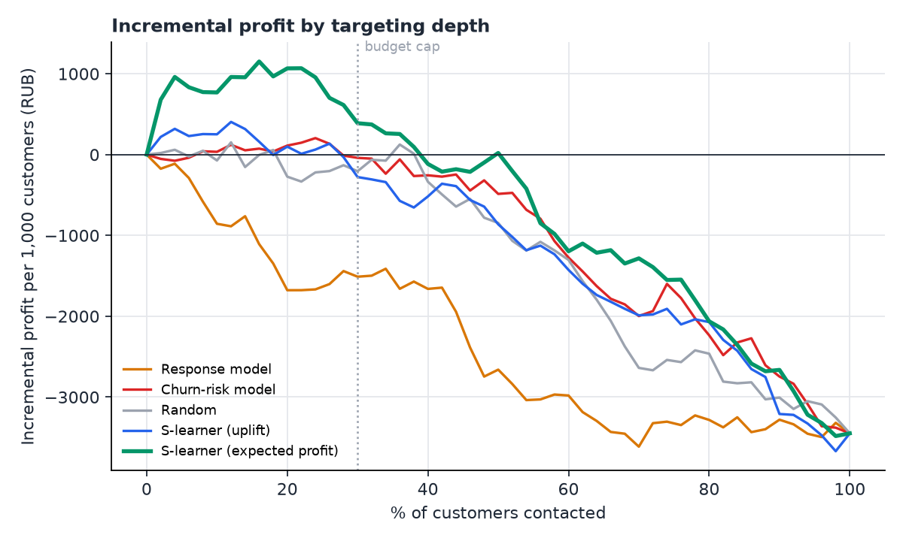
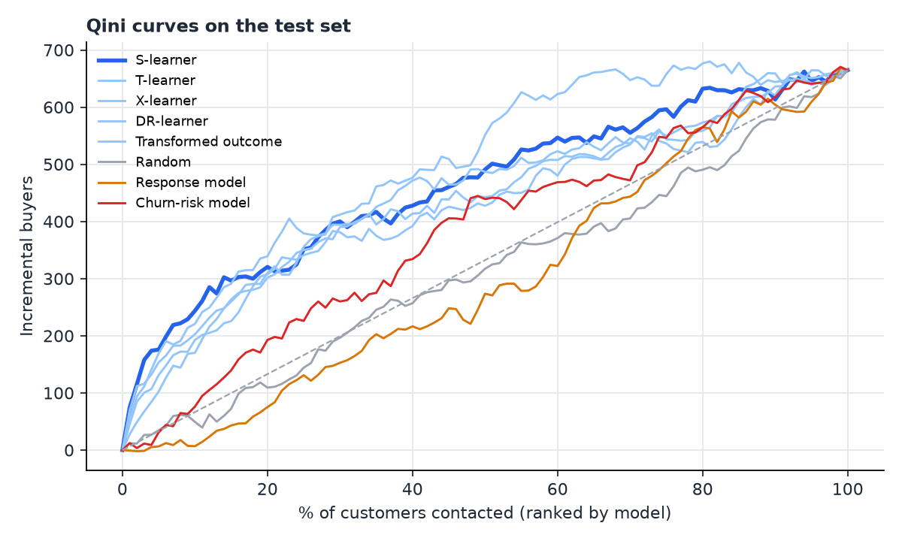
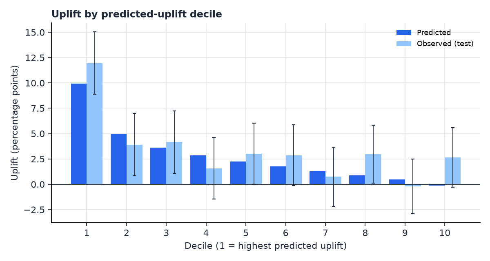
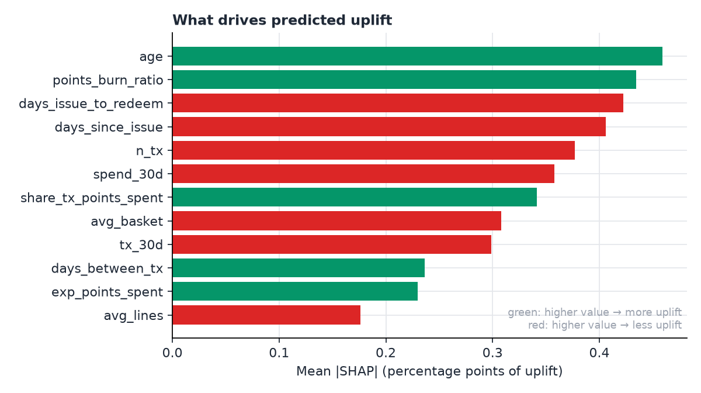

# Results

**Dataset:** `x5` · train 120,023 / valid 40,008 / test 40,008 customers · treated share 50% · average effect of the campaign on test: +3.32 pp on a 60.3% base purchase rate.

#### Does targeting by uplift make money? (test set, per 1,000 customers in the base)

| policy                                | contacted   | uplift_in_targeted   | profit_per_1000   | 95% CI           |
|:--------------------------------------|:------------|:---------------------|:------------------|:-----------------|
| Contact nobody                        | 0%          |                      | 0                 | [0, 0]           |
| Contact everybody                     | 100%        | +0.033               | -3,449            | [-5,346, -1,495] |
| Random 30%                            | 30%         | +0.032               | -206              | [-1,274, 917]    |
| Response model, top 30%               | 30%         | +0.025               | -1,511            | [-2,561, -422]   |
| Churn-risk model, top 30%             | 30%         | +0.044               | -40               | [-985, 820]      |
| S-learner uplift, top 30%             | 30%         | +0.066               | -278              | [-1,150, 664]    |
| S-learner expected profit > 0 (≤ 30%) | 9%          | +0.100               | 922               | [-223, 1,878]    |

#### Ranking quality
Model selected on validation Qini: **S-learner**. Higher Qini = better ranking of who the offer moves.

| model               | kind     | qini_valid   | qini_test   | uplift@10%   | uplift@30%   |
|:--------------------|:---------|:-------------|:------------|:-------------|:-------------|
| S-learner           | uplift   | 0.017        | 0.016       | 0.120        | 0.066        |
| T-learner           | uplift   | 0.015        | 0.015       | 0.099        | 0.065        |
| X-learner           | uplift   | 0.015        | 0.014       | 0.110        | 0.065        |
| DR-learner          | uplift   | 0.017        | 0.011       | 0.097        | 0.064        |
| Transformed outcome | uplift   | 0.011        | 0.019       | 0.080        | 0.068        |
| Random              | baseline |              | -0.002      | 0.024        | 0.032        |
| Response model      | baseline |              | -0.004      | 0.003        | 0.025        |
| Churn-risk model    | baseline |              | 0.006       | 0.039        | 0.044        |

#### Is the predicted uplift trustworthy?

#### Who are the persuadables?
Surrogate fidelity R² = 0.95.

Median profile of the customers the model ranks highest vs lowest:

| feature              | top 20% uplift   | bottom 20% uplift   | all customers   |
|:---------------------|:-----------------|:--------------------|:----------------|
| age                  | 55.00            | 39.00               | 45.00           |
| points_burn_ratio    | 1.36             | 0.59                | 0.77            |
| days_issue_to_redeem | 99.00            | 142.00              | 132.00          |
| days_since_issue     | 379.00           | 545.00              | 486.00          |
| n_tx                 | 10.00            | 34.00               | 15.00           |
| spend_30d            | 805.38           | 2,841.57            | 1,779.28        |

#### Sensitivity to campaign economics

| offer_cost   | contact_cost   | share_with_positive_expected_profit   | best_fraction_on_test   | profit_per_1000_at_best   |
|:-------------|:---------------|:--------------------------------------|:------------------------|:--------------------------|
| 7.5          | 1.25           | 27%                                   | 32%                     | 1,937                     |
| 7.5          | 2.5            | 17%                                   | 32%                     | 1,537                     |
| 7.5          | 5.0            | 8%                                    | 12%                     | 1,000                     |
| 15.0         | 1.25           | 14%                                   | 16%                     | 1,353                     |
| 15.0         | 2.5            | 9%                                    | 16%                     | 1,152                     |
| 15.0         | 5.0            | 5%                                    | 4%                      | 857                       |
| 30.0         | 1.25           | 5%                                    | 10%                     | 1,174                     |
| 30.0         | 2.5            | 4%                                    | 10%                     | 1,047                     |
| 30.0         | 5.0            | 2%                                    | 10%                     | 793                       |
